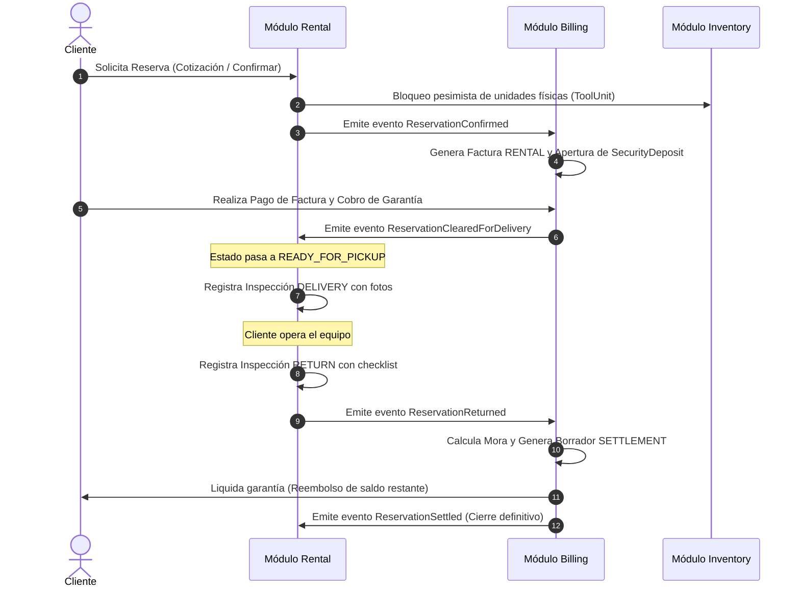
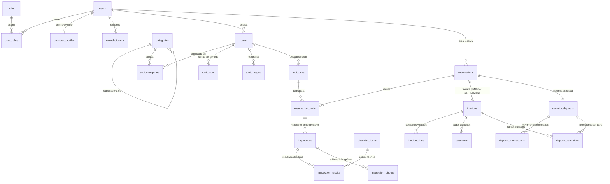

# RentaTools — Plataforma Integral de Alquiler de Maquinaria y Herramientas

<div align="center">


-6DB33F?style=for-the-badge&logo=springsecurity&logoColor=white)


<br/>

**Monolito Modular · Arquitectura Hexagonal (Ports & Adapters) · Domain-Driven Design (DDD) · Normalización 4FN**

### 👥 Desarrollado por:
**Kevin Castillo** & **Daniel Gamboa**

---

</div>

## 📑 Tabla de Contenidos

1. [Descripción General](#1-descripción-general)
2. [Habilidades y Competencias Técnicas (Skills)](#2-habilidades-y-competencias-técnicas-skills)
3. [Stack Tecnológico](#3-stack-tecnológico)
4. [Esquema de Estructura y Arquitectura](#4-esquema-de-estructura-y-arquitectura)
   - [4.1 Arquitectura Hexagonal y Monolito Modular](#41-arquitectura-hexagonal-y-monolito-modular)
   - [4.2 Árbol de Estructura del Proyecto](#42-árbol-de-estructura-del-proyecto)
   - [4.3 Comunicación entre Módulos y Eventos de Integración](#43-comunicación-entre-módulos-y-eventos-de-integración)
5. [Modelos de Base de Datos: Lógico y Físico](#5-modelos-de-base-de-datos-lógico-y-físico)
   - [5.1 Modelo Lógico (Diagrama ER Conceptual)](#51-modelo-lógico-diagrama-er-conceptual)
   - [5.2 Modelo Físico (Esquema Relacional DDL en 4FN)](#52-modelo-físico-esquema-relacional-ddl-en-4fn)
6. [Guía de Ejecución y Puesta en Marcha](#6-guía-de-ejecución-y-puesta-en-marcha)
   - [6.1 Requisitos Previos](#61-requisitos-previos)
   - [6.2 Ejecución con Docker Compose (Recomendada)](#62-ejecución-con-docker-compose-recomendada)
   - [6.3 Ejecución Local con Maven Wrapper y MySQL](#63-ejecución-local-con-maven-wrapper-y-mysql)
   - [6.4 Perfiles de Entorno](#64-perfiles-de-entorno)
7. [Usuarios y Cuentas Semilla de Prueba](#7-usuarios-y-cuentas-semilla-de-prueba)
8. [Validaciones de Seguridad y Formatos](#8-validaciones-de-seguridad-y-formatos)
9. [Documentación de la API REST](#9-documentación-de-la-api-rest)
10. [Pruebas Automatizadas y Calidad](#10-pruebas-automatizadas-y-calidad)
11. [Créditos y Autores](#11-créditos-y-autores)

---

## 1. Descripción General

**RentaTools** es una plataforma SaaS industrial de alta disponibilidad orientada al alquiler profesional, seguro y formalizado de maquinaria pesada, equipos de construcción y herramientas especializadas. Conecta de manera fluida a **Proveedores** (dueños de maquinaria y empresas de alquiler) con **Clientes** (contratistas, constructores y profesionales).

### Problemas Críticos que Resuelve:
- **Disponibilidad física garantizada en tiempo real**: Control estricto a través de fichas maestras de herramientas y seriales físicos individuales (`ToolUnit`), impidiendo la sobreventa mediante bloqueos pesimistas y validación de no solapamiento temporal de fechas.
- **Seguridad en garantías y depósitos**: Apertura, cobro, retención por daños y reembolso automatizado de depósitos de seguridad (`SecurityDeposit`) respaldados por transacciones monetarias auditadas.
- **Facturación y liquidación transparente**: Emisión automatizada de facturas de alquiler (`RENTAL`) y facturas de liquidación final (`SETTLEMENT`) con cálculo paramétrico de días de mora y cargos técnicos por daños.
- **Inspecciones físicas con evidencia fotográfica**: Checklists técnicos y registro de estado físico en las dos fases obligatorias: entrega en obra (`DELIVERY`) y recepción en almacén (`RETURN`).

---

## 2. Habilidades y Competencias Técnicas (Skills)

El desarrollo del proyecto refleja dominio senior en el ecosistema empresarial **Java / Spring Boot** y arquitectura de software:

* **Arquitectura de Software y DDD**:
  - Implementación de **Monolito Modular** desacoplado por Bounded Contexts.
  - Aplicación pura de **Arquitectura Hexagonal (Ports & Adapters)** donde el núcleo de dominio no tiene dependencias de frameworks.
  - Fronteras arquitectónicas verificadas mediante **ArchUnit**.
* **Spring Boot 3.5 & Java 21**:
  - Aprovechamiento exhaustivo de **Java 21 LTS** (Records inmutables, Pattern Matching, Sealed Interfaces, Instant/LocalDate).
  - Manejo de identificadores **UUID v7** (ordenados cronológicamente para optimizar los índices B-Tree de la BD).
  - Configuración declarativa, inversión de control y auto-configuración de Spring Boot.
* **Seguridad Robusta (Spring Security 6.5)**:
  - Autenticación **Stateless** basada en tokens **JWT (Nimbus / OAuth2 Resource Server)** con par de claves y HMAC-SHA256.
  - Autorización granular basada en roles (`CLIENTE`, `PROVEEDOR`, `ADMIN`) mediante `@PreAuthorize`.
  - Hashing criptográfico seguro con **BCrypt** y protección contra fuerza bruta.
* **Persistencia y Modelado Relacional (4FN)**:
  - Diseño y normalización rigurosa de base de datos hasta la **Cuarta Forma Normal (4FN)**.
  - Control de versiones del esquema y datos semilla con **Flyway Migrations**.
  - Mapeo ORM con **Spring Data JPA e Hibernate 6.6+**, con control de concurrencia optimista (`@Version`).
* **Frontend Moderno y Reactivo sin Dependencias Pesadas**:
  - Single/Multi-Page Application construida con **HTML5 semántico**, **Vanilla JavaScript modular ES6** y **CSS3 moderno**.
  - Validación de formularios reactiva en tiempo real con sanitización estricta (restringir solo números en teléfonos, validación de correo, longitud de contraseña y NIT).

---

## 3. Stack Tecnológico

| Capa / Rol | Tecnología | Versión | Descripción y Propósito |
|---|---|---|---|
| **Lenguaje Core** | **Java** | **21 LTS** | Uso de records, pattern matching, time API inmutable y UUID v7. |
| **Framework Base** | **Spring Boot** | **3.5.13** | Framework empresarial para orquestación e inyección de dependencias. |
| **Seguridad** | **Spring Security** | **6.5.x** | Autenticación stateless, JWT Bearer tokens, control RBAC estricto. |
| **Persistencia** | **Spring Data JPA / Hibernate** | **6.6+** | ORM transaccional, bloqueos optimistas y consultas con JPQL/Criteria. |
| **Base de Datos** | **MySQL Server** | **8.4 LTS** | Motor transaccional InnoDB, charset `utf8mb4_0900_ai_ci`, checks y FKs. |
| **Migraciones de BD** | **Flyway** | **11.x** | Evolución controlada de DDL y scripts semilla reproducibles. |
| **Documentación API** | **Springdoc OpenAPI** | **2.8.6** | Generación interactiva de Swagger UI (`/swagger-ui.html`) y spec OpenAPI 3. |
| **Testing Arquitectura** | **ArchUnit** | **1.4.1** | Validación en build de la pureza hexagonal y ausencia de ciclos entre módulos. |
| **Testing Integración** | **Testcontainers** | **1.20.x** | Pruebas automáticas contra contenedores reales de MySQL 8.4 en Docker. |
| **Contenedores** | **Docker & Docker Compose** | **v2** | Empaquetado en contenedor Eclipse Temurin 21 multi-stage. |
| **Frontend** | **HTML5 / CSS3 / Vanilla JS** | **ES6+** | Interfaz web industrial SaaS, dark mode, paleta HSL y Bootstrap 5.3 CDN. |

---

## 4. Esquema de Estructura y Arquitectura

### 4.1 Arquitectura Hexagonal y Monolito Modular

El sistema está estructurado como un **Monolito Modular** gobernado por **Domain-Driven Design (DDD)**. Cada Bounded Context posee aislamiento hexagonal estricto:

```
┌────────────────────────────────────────────────────────────────────────┐
│                        INFRASTRUCTURE ADAPTERS                         │
│  Controllers REST (@RestController)   │   JPA Entities & Repositories  │
│  Event Listeners (@EventListener)    │   BCrypt, JWT Issuer, Storage   │
├────────────────────────────────────────────────────────────────────────┤
│                           APPLICATION LAYER                            │
│  Inbound Ports (Use Cases / Commands) │   Outbound Ports (Gateways)    │
│  Application Services Orchestrators  │   Command / Query DTOs         │
├────────────────────────────────────────────────────────────────────────┤
│                              DOMAIN LAYER                              │
│       Aggregate Roots  │  Entities  │  Value Objects  │  Events        │
│       (100% Java Puro — Cero dependencias de Spring o Jakarta)         │
└────────────────────────────────────────────────────────────────────────┘
```

### 4.2 Árbol de Estructura del Proyecto

```text
Proyecto_RentaHerramientas/
├── .mvn/wrapper/                       # Binarios y propiedades de Maven Wrapper
├── compose.yaml                        # Orquestación Docker para App + MySQL 8.4
├── Dockerfile                          # Build multi-stage optimizado (Eclipse Temurin 21)
├── pom.xml                             # Declaración de dependencias y plugins Maven
│
├── docs/                               # Documentación formal y diagramas
│   ├── arquitectura/
│   │   ├── DDL-4FN.md                  # Especificación formal de normalización y DDL
│   │   └── PLAN.md                     # Bitácora y especificaciones de arquitectura
│   ├── modelo_logico_fisico/
│   │   ├── image.png                   # Diagrama del Modelo Lógico (ER Conceptual)
│   │   └── Ddl.png                     # Diagrama del Modelo Físico (dbdiagram.io DDL)
│   ├── COMPILACION.md                  # Guía detallada de compilación y empaquetado
│   └── DESPLIEGUE.md                   # Guía de despliegue en Docker y Tomcat
│
├── src/main/java/com/rentatools/
│   ├── RentaToolsApplication.java      # Clase principal con @SpringBootApplication
│   │
│   ├── shared/                         # Kernel compartido (Cross-Cutting & DDD Core)
│   │   ├── domain/                     # Money, DateRange, Actor, UUID v7 Id
│   │   ├── infrastructure/             # GlobalExceptionHandler (RFC 9457 ProblemDetail)
│   │   └── integration/                # Eventos de integración inter-módulos
│   │
│   ├── iam/                            # Módulo IAM (Identidad y Accesos)
│   │   ├── domain/                     # User, Role, ProviderProfile, RefreshToken
│   │   ├── application/                # RegisterClient, RegisterProvider, LoginUseCase
│   │   └── infrastructure/             # AuthController, SecurityConfig, JwtService
│   │
│   ├── inventory/                      # Módulo INVENTORY (Catálogo y Unidades Físicas)
│   │   ├── domain/                     # Tool, ToolUnit, Rate, Category, ToolImage
│   │   ├── application/                # ToolManagement, UnitTracking, SearchCatalog
│   │   └── infrastructure/             # ToolController, ToolJpaEntity, CatalogAdapter
│   │
│   ├── rental/                         # Módulo RENTAL (Reservas e Inspecciones)
│   │   ├── domain/                     # Reservation, ReservationUnit, Inspection
│   │   ├── application/                # CreateQuote, ConfirmReservation, InspectUnit
│   │   └── infrastructure/             # ReservationController, InspectionController
│   │
│   └── billing/                        # Módulo BILLING (Facturas y Garantías)
│       ├── domain/                     # Invoice, Payment, SecurityDeposit, DamageCharge
│       ├── application/                # GenerateInvoice, ProcessPayment, SettleDeposit
│       └── infrastructure/             # BillingController, InvoiceJpaEntity, Reports
│
└── src/main/resources/
    ├── application.yml                 # Configuración general base del sistema
    ├── application-dev.yml             # Perfil de desarrollo (seeder y reloj simulado)
    ├── application-prod.yml            # Perfil de producción optimizado
    │
    ├── db/migration/                   # Scripts Flyway reproducibles
    │   ├── V1__create_schema.sql       # Tablas base, constraints y FKs
    │   ├── V2__audit_triggers.sql      # Triggers y auditoría
    │   ├── V3__indexes_and_checks.sql  # Índices funcionales y restricciones CHECK
    │   ├── V4__foreign_keys.sql        # Claves foráneas estrictas
    │   └── V5__seed_data.sql           # Datos semilla (usuarios, herramientas y unidades)
    │
    └── static/                         # Frontend Web SaaS (Client-side)
        ├── index.html                  # Landing page de bienvenida
        ├── catalog.html                # Catálogo público interactivo con filtros
        ├── auth.html                   # Login y Registro dual (Cliente / Proveedor)
        ├── admin-dashboard.html        # Panel administrativo y métricas
        ├── provider-dashboard.html     # Panel de gestión de maquinaria del proveedor
        ├── client-reservations.html    # Panel de seguimiento y pago de reservas
        ├── invoice-view.html           # Visualizador e impresión de facturas
        ├── css/styles.css              # Sistema de diseño CSS industrial oscuro
        ├── js/                         # Lógica modular de cliente (auth.js, etc.)
        └── images/                     # Logotipo, fondos y fotos de herramientas
```

### 4.3 Comunicación entre Módulos y Eventos de Integración

Para mantener el desacoplamiento y evitar ciclos de dependencia, los módulos se comunican de forma síncrona mediante interfaces `api` y de forma asíncrona mediante **Eventos de Dominio e Integración**:



---

## 5. Modelos de Base de Datos: Lógico y Físico

El diseño de datos ha sido estructurado meticulosamente para garantizar la integridad referencial y cumplir con la **Cuarta Forma Normal (4FN)**, separando dependencias multivaluadas y optimizando las consultas.

### 5.1 Modelo Lógico (Diagrama ER Conceptual)

El modelo lógico define las entidades conceptuales del negocio y sus relaciones cardinales, desacoplando los agregados de usuarios, catálogo, reservas físicas, inspecciones y facturación:

<div align="center">


*Figura 1: Diagrama Entidad-Relación Lógico de RentaTools.*  
[🔍 Ver imagen en alta resolución](docs/modelo_logico_fisico/image.png)

</div>

#### Diagrama de Entidades y Relaciones (Mermaid):



---

### 5.2 Modelo Físico (Esquema Relacional DDL en 4FN)

El modelo físico detalla la implementación exacta en **MySQL 8.4 InnoDB**, indicando tipos de datos de precisión monetaria (`DECIMAL(12,2)`), marcas de tiempo UTC (`DATETIME(6)`), claves primarias binarias ordenadas (`BINARY(16)` con **UUID v7**) y control de versiones optimista (`version BIGINT`):

<div align="center">


*Figura 2: Diagrama Físico de Base de Datos generado en dbdiagram.io.*  
[🔍 Ver imagen en alta resolución](docs/modelo_logico_fisico/Ddl.png)

</div>

#### Características del Diseño Físico 4FN:
1. **Identificadores UUID v7 en `BINARY(16)`**: Permite inserciones secuenciales rápidas en el árbol B+ del índice agrupado `PRIMARY KEY`, evitando la fragmentación causada por UUIDs v4 aleatorios.
2. **Eliminación de Dependencias Multivaluadas**:
   - `tool_rates`, `tool_categories` y `tool_images` se encuentran completamente desacopladas de la tabla `tools`.
   - Las inspecciones (`inspections`) separan de manera independiente los puntos evaluados del checklist (`inspection_results`) de los registros fotográficos (`inspection_photos`).
3. **Manejo de Estados Temporales Inmutables**: Los estados de facturas y depósitos se auditan cronológicamente (`issued_at`, `voided_at`, `settled_at`) asegurando trazabilidad contable.

---

## 6. Guía de Ejecución y Puesta en Marcha

### 6.1 Requisitos Previos

| Requisito | Versión Requerida | Comprobación en Terminal |
|---|---|---|
| **JDK (Java Development Kit)** | **Java 21 LTS** | `java -version` |
| **Docker & Docker Compose** | Docker v24+ / Compose v2 | `docker compose version` |
| **Git** | 2.x | `git --version` |
| **Navegador Web** | Chrome, Edge, Firefox moderno | — |

---

### 6.2 Ejecución con Docker Compose (Recomendada)

Es la forma más rápida y reproducible de iniciar la plataforma, ya que compila la imagen multi-stage de Spring Boot e inicializa el contenedor de MySQL 8.4 con los volúmenes configurados:

1. **Clonar el repositorio**:
   ```bash
   git clone https://github.com/castillokfirex/Proyecto_RentaHerramientas_kevin_castillo_daniel_gamboa.git
   cd Proyecto_RentaHerramientas_kevin_castillo_daniel_gamboa
   ```

2. **Compilar y levantar todos los servicios**:
   ```bash
   docker compose up -d --build
   ```

3. **Verificar el estado de los contenedores**:
   ```bash
   docker compose ps
   ```
   *Debe mostrar `rentatools-mysql` en estado `healthy` y `rentatools-app` en estado `running`.*

4. **Acceder a la aplicación**:
   - 🌐 **Plataforma Web**: [http://localhost:8080](http://localhost:8080)
   - 📚 **Documentación Swagger UI**: [http://localhost:8080/swagger-ui.html](http://localhost:8080/swagger-ui.html)
   - 🔐 **Pantalla de Autenticación**: [http://localhost:8080/auth.html](http://localhost:8080/auth.html)

5. **Detener el entorno**:
   ```bash
   docker compose down
   ```

---

### 6.3 Ejecución Local con Maven Wrapper y MySQL

Si desea ejecutar el código localmente para desarrollo y depuración:

1. **Levantar únicamente el servicio de base de datos MySQL 8.4**:
   ```bash
   docker compose up -d mysql
   ```

2. **Ejecutar la aplicación Spring Boot con Maven Wrapper (perfil `dev`)**:
   - **En Windows (PowerShell / CMD)**:
     ```powershell
     .\mvnw.cmd spring-boot:run -Dspring-boot.run.profiles=dev
     ```
   - **En Linux / macOS**:
     ```bash
     ./mvnw spring-boot:run -Dspring-boot.run.profiles=dev
     ```

3. **Las migraciones de Flyway se aplicarán automáticamente** al arrancar, creando el esquema completo e insertando los datos de prueba (`V1` a `V5`).

---

### 6.4 Perfiles de Entorno

| Perfil | Archivo | Propósito y Comportamiento |
|---|---|---|
| `default` | `application.yml` | Configuración base del sistema, puerto `8080` y variables de conexión por defecto. |
| `dev` | `application-dev.yml` | Modo desarrollo: habilita el reloj simulado (`/api/v1/dev/clock`) y seeder de usuarios. |
| `prod` | `application-prod.yml` | Modo producción: compresión HTTP Gzip, logging optimizado y variables de entorno estrictas. |
| `test` | `application-test.yml` | Modo pruebas: integración con Testcontainers e instancias efímeras de MySQL. |

---

## 7. Usuarios y Cuentas Semilla de Prueba

Para facilitar la evaluación y auditoría funcional, la base de datos incluye cuentas precargadas en `V5__seed_data.sql`:

| Rol | Correo Electrónico | Contraseña | Perfil / Empresa Asociada |
|---|---|---|---|
| **ADMIN** | `admin.dev@rentatools.com` | `Password123!` | Administrador de Plataforma Dev |
| **ADMIN** | `admin@rentatools.com` | `Admin1234!` | Administrador Principal del Sistema |
| **PROVEEDOR** | `proveedor1.dev@rentatools.com` | `Password123!` | **Herramientas del Norte SAS** (Aprobado) |
| **PROVEEDOR** | `proveedor2.dev@rentatools.com` | `Password123!` | **Equipos Industriales Sur SAS** (Aprobado) |
| **CLIENTE** | `cliente.dev@rentatools.com` | `Password123!` | **Carlos Gómez** (Cliente Activo) |
| **CLIENTE** | `cliente1@rentatools.com` | `Password123!` | **Ana María Torres** (Cliente Activo) |

> [!TIP]
> **Acceso Rápido con 1 Clic**: En la pantalla de inicio de sesión (`auth.html`), se encuentra disponible una barra interactiva de **"Cuentas de Prueba"** que autocompleta las credenciales y permite iniciar sesión de inmediato con un solo clic.

---

## 8. Validaciones de Seguridad y Formatos

El sistema incorpora un robusto esquema de validación en dos capas (Frontend y Backend):

### 8.1 Validaciones en el Cliente (Frontend UI/UX)
- **Número de Teléfono (Solo Números)**:
  - Escuchadores de eventos `input` y `paste` que impiden la escritura de letras, signos o espacios mediante regex `/\D/g`.
  - Configuración con `inputmode="numeric"`, `pattern="[0-9]{7,15}"` y límite de 15 dígitos.
- **Correo Electrónico**:
  - Sanitización con eliminación de espacios y validación estricta de estructura (`usuario@dominio.ext`).
- **Contraseña**:
  - Validación de longitud mínima de **8 caracteres** y máximo de 72 caracteres (límite del algoritmo BCrypt).
- **Nombres y Representantes**:
  - Restricción contra caracteres numéricos; solo admite letras del alfabeto, tildes, diéresis, espacios y guiones.
- **NIT / RUC**:
  - Transformación automática a mayúsculas con caracteres alfanuméricos y guiones (5 a 20 caracteres).
- **Feedback Visual en Tiempo Real**:
  - Resaltado de campos con error (`.is-invalid`), mensaje descriptivo con icono (`.rt-auth-field-error`) y limpieza automática conforme el usuario realiza correcciones.

### 8.2 Validaciones en el Backend (API REST)
- Uso de anotaciones de Jakarta Bean Validation (`@NotNull`, `@NotBlank`, `@Size`, `@Email`, `@PositiveOrZero`).
- Manejo centralizado de excepciones con **RFC 9457 `ProblemDetail`**, devolviendo mensajes detallados por campo ante errores HTTP 400.

---

## 9. Documentación de la API REST

La API REST opera bajo el prefijo `/api/v1` y está documentada mediante la especificación OpenAPI 3.

### 9.1 Acceso a Swagger UI
Una vez arrancada la aplicación, navegue a:  
👉 **`http://localhost:8080/swagger-ui.html`**

Para autorizarse en Swagger UI:
1. Envíe una petición `POST /api/v1/auth/login` con credenciales de prueba.
2. Copie el token del campo `accessToken`.
3. Haga clic en el botón verde **Authorize** e introduzca: `Bearer <accessToken>`.

### 9.2 Endpoints Clave del Sistema

```text
AUTENTICACIÓN & USUARIOS (IAM)
├── POST /api/v1/auth/login                      -> Iniciar sesión y obtener JWT
├── POST /api/v1/auth/register/client            -> Registro público de cuenta Cliente
├── POST /api/v1/auth/register/provider          -> Registro de Proveedor (requiere aprobación)
├── GET  /api/v1/users/me                        -> Perfil del usuario autenticado
└── GET  /api/v1/admin/users                     -> Listado y aprobación de usuarios (ADMIN)

CATÁLOGO & INVENTARIO (INVENTORY)
├── GET  /api/v1/tools                           -> Catálogo público con filtros y paginación
├── GET  /api/v1/tools/{id}                      -> Detalle de herramienta, tarifas e imágenes
├── POST /api/v1/tools                           -> Publicar nueva maquinaria (PROVEEDOR)
└── GET  /api/v1/tools/{id}/units                -> Gestión de seriales físicos y estado

RESERVAS E INSPECCIONES (RENTAL)
├── POST /api/v1/rental/quotes                   -> Cotizar alquiler según fechas y tarifas
├── POST /api/v1/rental/reservations             -> Crear y confirmar reserva con bloqueo físico
├── GET  /api/v1/rental/reservations/me          -> Historial de reservas del cliente
└── POST /api/v1/rental/inspections              -> Registrar inspección DELIVERY o RETURN

FACTURACIÓN Y GARANTÍAS (BILLING)
├── GET  /api/v1/billing/reservations/{id}       -> Estado de factura RENTAL y depósito
├── POST /api/v1/billing/invoices/{id}/payments  -> Registrar pago de factura
├── GET  /api/v1/pagos/cliente/{id}              -> Historial de pagos del cliente autenticado
├── POST /api/v1/billing/reservations/{id}/deposit/collections -> Registrar cobro de garantía
├── POST /api/v1/billing/reservations/{id}/settle -> Liquidar reserva y reembolsar garantía
└── GET  /api/v1/admin/reports/revenue           -> Reporte consolidado de ingresos (ADMIN)
```

---

## 10. Pruebas Automatizadas y Calidad

El proyecto dispone de una suite de pruebas estructurada para garantizar la robustez del código:

### Ejecución de Pruebas Unitarias y de Integración:
```powershell
# En Windows
.\mvnw.cmd test

# En Linux / macOS
./mvnw test
```

### Tipos de Pruebas Incluidas:
1. **Pruebas de Arquitectura (ArchUnit)**:
   - Verifican que la capa de dominio permanezca 100% aislada de frameworks externos.
   - Comprueban la ausencia de dependencias circulares entre los Bounded Contexts.
2. **Pruebas de Integración (Testcontainers)**:
   - Ejecutan pruebas contra una instancia real de MySQL 8.4 levantada dinámicamente en contenedor Docker.
3. **Pruebas de Seguridad y Control de Acceso (Spring Security Test)**:
   - Verifican la denegación de accesos no autorizados (HTTP 401 y 403) ante rutas protegidas por roles.

---

## 11. Créditos y Autores

Proyecto desarrollado como solución integral de ingeniería de software por:

* **Kevin Castillo**
* **Daniel Gamboa**

---

<div align="center">

*RentaTools — Alquila, construye, avanza.*  
© 2026 RentaTools Inc. Todos los derechos reservados.

</div>
